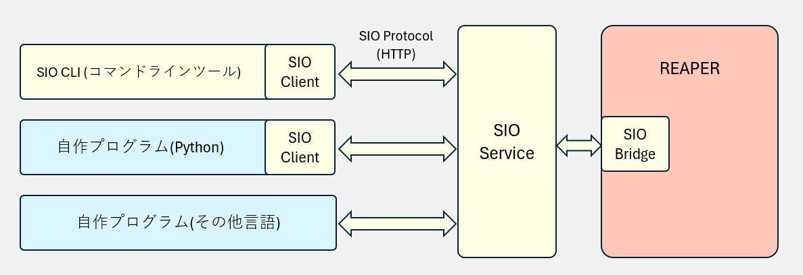

# REAPER Score IO (SIO)

日本語 | [English](README_en.md)

REAPER SIO は、音楽制作ソフト REAPER のピアノロールに入力された音符を、研究用・教育用のプログラムから読み書きするための共通インタフェースです。

作曲・編曲の研究者が、楽曲分析のプログラムや作曲支援のプログラムあるいは対話型の教材を作るときに使うことを想定しています。

## 背景と目的

これまでコンピュータによる作曲・編曲支援のような作曲者とのインタラクションを研究するには、研究者が簡易的なピアノロールを自作し簡易的な音源で鳴らす必要がありました。しかし入力のしやすさも音色の品質も、実際の音楽制作で使われる道具には及びません。研究テーマごとにピアノロールを作り直す手間もかかります。

また楽譜で説明する古典的な作曲・編曲の教材は、楽譜を見てすぐに弾ける人、正確な音を頭の中で鳴らせる人でなければ、効率よく学ぶことができません。


SIO は、この部分を制作用のソフトウェアに任せます。

- **入力と編集**は、REAPER の本格的なピアノロールで行います。
- **音**は、REAPER に読み込んだ商用ソフトウェア音源で鳴らします。
- **分析・評価**は、研究者が書くプログラムが担当します。
- SIO は両者の間に立ち、音符のデータを受け渡します。

研究者は、ピアノロールや音源を自作する代わりに、分析と教材の中身に集中できます。SIO という共通の窓口を使うことで、分析プログラムや教材を別々の人が作っても、同じ REAPER の上で動かせます。



## SIO でできること

プログラムから、次のことができます。対象は、REAPER で表に出ているタブの曲です。学習者が REAPER でトラックを選んだり、何かのボタンを押したりする必要はありません。

| できること | 例 |
|---|---|
| 音符を読み取る | 全パートの音符、第1〜2小節の音符、第4小節第2拍で鳴っている音符 |
| 音符を選択する | 連続5度になっている2音をピアノロール上で選択状態にして示す |
| 音符を追加・変更・削除する | 模範解答を書き込む、指摘した音を直す |
| 範囲を再生する | 問題のある2小節だけを鳴らす |
| 曲の情報を読む | パート（トラック）の一覧、拍子、音符のある範囲 |
| 曲やパートを用意する | 新しい曲を作る、音源を載せたトラックを追加する、解答を入力する小節を用意する |

音符は、音高（MIDI ノート番号）、開始位置、長さ、ベロシティなどの数値として受け渡します。位置は、四分音符を 1 とする数値でも、小節と拍でも指定できます。

SIO 自身は音楽的な判断をしません。和声分析、声部の推定、異名同音の区別、採点などは、SIO を使うプログラムの側で行います。SIO が扱うのはピアノロール上の音符そのものです。

## 動作に必要なもの

- macOS または Windows 11（動作を確認した環境です。Linux は未確認です）
- [REAPER](https://www.reaper.fm/) 7.x
- [Python](https://www.python.org/) 3.11 以降

## 使い始める

### 1. SIO を準備する

ターミナルを開き、このフォルダで次のコマンドを順に実行します。最初の1回だけ必要です。

```bash
python3 -m pip install -r requirements.txt
python3 -m sio_service.install
```

2行目は、REAPER の中で動く部品（SIO Bridge）を REAPER に組み込みます。実行後に REAPER を再起動してください。以後、REAPER を起動するたびに Bridge も自動で動きます。

### 2. REAPER で曲を用意する

REAPER で曲を開き、パートごとにトラックを作って MIDI アイテムを置きます。SIO は **名前の付いたトラック1本を1パート** として扱うので、トラックには「Soprano」「Cello」のように、重複しない名前を付けてください。

トラックは SIO からも追加できます（手順4の sio_cli で `add_track "Cello" "音源名"`）。指定した音源が見つからないときは、音源のないトラックが追加されます。MIDI アイテムも `add_item "Cello" b1..b9`（第1〜8小節）のように追加できます。

### 3. SIO Service を起動する

```bash
python3 -m sio_service
```

このウィンドウは開いたままにします。SIO を使う間は、REAPER と SIO Service の両方が動いている必要があります。

### 4. 手で動かして確かめる

別のウィンドウで、確認用のツール sio_cli を起動します。

```bash
python3 -m sio_cli
```

`sio> ` と表示されたら、コマンドを入力します。結果は JSON 形式で表示されます。

```
sio> get_status                      接続できているかを確認する
sio> get_score_info                  パートの一覧と拍子を見る
sio> get_notes                       全パートの音符を読む
sio> get_notes Cello range=b1..b3    Cello の第1〜2小節を読む
sio> get_notes at=4:2                第4小節第2拍で鳴っている音符を読む
sio> select_notes Cello:C3@4:2       Cello の第4小節第2拍の C3 を選択する
sio> play_range b1..b3               第1〜2小節を再生する
sio> insert Cello:G2@5:1 dur=2       Cello の第5小節第1拍に、四分音符2つ分の長さの G2 を追加する
sio> create_project                  新しい曲を作る
sio> add_track Viola ReaSynth        音源 ReaSynth を載せたトラック Viola を追加する
sio> add_item Viola b1..b9           Viola の第1〜8小節に、音符を入力できる空の MIDI アイテムを作る
sio> help                            コマンドの一覧を見る
sio> exit                            終了する
```

`get_status` の結果で `"bridge_state": "connected"` となっていれば、REAPER とつながっています。編集した内容は、REAPER の通常の「元に戻す」1回で取り消せます。

### 5. 自分のプログラムから使う

Python のプログラムからは、付属のライブラリ sio_client を使います。自分のプログラムを動かす Python に、次のコマンドで導入します（追加でインストールされるものはありません）。

```bash
python3 -m pip install ~/ReaperScoreInterface
```

フォルダの場所は、SIO を置いた場所に読み替えてください。導入したら、次のように書けます。

```python
from sio_client import SIO

sio = SIO()                                   # 接続先は自動で見つけます

# 第1〜2小節の音符を、全パートから読み取る。
for note in sio.notes(bars=(1, 2)):
    print(note.part, note.pitch, f"第{note.bar}小節 第{note.beat}拍", note.duration)

# 高すぎる音を REAPER 上で選択状態にして示し、その小節を鳴らす。
too_high = [n for n in sio.notes("Soprano") if n.pitch > 81]
if too_high:
    sio.select_notes(too_high)
    sio.play(bars=too_high[0].bar, wait=True)

# Bass の第5小節第1拍に、四分音符2つ分の長さの C3 を追加する。
sio.insert("Bass", "C3", (5, 1), duration=2)
```

位置は `(小節, 拍)` か、四分音符を 1 とする数値で書きます。音高は MIDI ノート番号か、`"C4"`（＝60）のような音名で書きます。使えるメソッドの一覧は [SIO_Client_Library_Specification_ja.md](SIO_Client_Library_Specification_ja.md) にあります。

そのまま動かせるサンプルプログラムが [examples](examples/README.md) フォルダにあります。「かえるの合唱」の輪唱、和音の解析、連続5度の検出、和声課題の出題と評価の4つです。たとえば次のように実行します。

```bash
python3 examples/frog_round.py
```

Python 以外の言語からも使えます。SIO は、同じパソコンの中だけで通じる HTTP の窓口を用意しており、JSON の要求を送ると JSON の応答が返ります。形式は [SIO_Protocol_Specification_en.md](SIO_Protocol_Specification_en.md) にあります。

和声課題の教材であれば、流れはおおよそ次のようになります。

1. プログラムが課題を出す（「次のバスに上3声を付けなさい」）。
2. 学習者が REAPER のピアノロールに解答を入力し、音源で確かめる。
3. 学習者がプログラム上で「提出」する。プログラムは `sio.notes(...)` で該当の小節を読み取る。
4. プログラムが解答を評価する。問題のある音を `sio.select_notes(...)` で選択状態にし、`sio.play(...)` でその箇所を鳴らす。
5. 学習者が直して、もう一度提出する。

## 曲を用意するときの注意

SIO が正しく読み書きできるよう、教材や分析対象の曲は次のように作ってください。条件に合わない場合、SIO は黙って読み飛ばさずに、理由を付けてエラーや警告を返します。`get_score_info` で、曲のどこが条件に合っていないかを確認できます。

- **パートのトラックには、重複しない名前を付ける。** 名前のないトラックはパートとして扱われません。
- **曲は完全な小節から始める。** 弱起（アウフタクト）には対応していません。弱起の曲は、第1小節を休符で埋めて始めてください。
- **拍子の変更は小節の頭で行う。** テンポの変更は自由にできます。
- **MIDI アイテムは普通に作ったものを使う。** 複数テイク、重ねて置いたアイテム、ループで引き伸ばしたアイテム、共有（プール）したアイテムは扱えません。1つのトラックに複数のアイテムを並べるのは問題ありません。
- **同じ高さの音を、同じチャンネルで重ねない。**
- **アイテムの端をまたぐ音符を作らない。** アイテムを縮めるときは、音符がはみ出さないようにしてください。

## 知っておくとよいこと

- **1拍の数え方**：SIO の「拍」は拍子の分母の音符です。6/8 拍子は1小節が6拍で、付点四分音符2拍とは数えません。
- **音符の番号（note_id）は一時的なもの**：読み取った音符には、パートごとに 1 から番号が付きます。音符を追加・削除すると番号は振り直されるので、編集のあとは読み取り直してください。番号の代わりに「音高と開始位置」で音符を指定することもできます。
- **表に出ているタブの曲が対象です**：SIO は、REAPER で表に出ているタブの曲を読み書きします。複数の曲を開いているときにタブを切り替えると、対象も切り替わります。プログラムから `select_project` で曲を指定すると、その曲のタブが表に出ます。REAPER でどのトラックを選んでいるかは影響しません（プログラムが `select_part` でパートを選ぶと、REAPER でもそのトラックが選択されますが、人が別のトラックを選び直しても、プログラムの対象は変わりません）。
- **同じパソコンの中だけで使います**：SIO はネットワークの外からの接続を受け付けません。
- **保存はしません**：SIO は曲を自動で保存しません。SIO で作った新しい曲も、保存は REAPER で行ってください。
- **音源の設定は REAPER で行います**：SIO は音源をトラックに載せるところまでを行います。音色（プリセット）の選択やつまみの操作は REAPER で行ってください。

## なぜ REAPER なのか

本格的な音楽制作ソフト（DAW）はいくつもありますが、SIO は REAPER だけを対象にしています。理由は次のとおりです。

- **外部のプログラムから音符を読み書きできる。** REAPER には、ソフトの内部を操作するための公開された仕組み（ReaScript）があり、ピアノロールの音符を1つずつ取得・変更できます。多くの DAW にはこの種の仕組みがないか、あっても音符の中身までは扱えません。SIO が成り立つための前提です。
- **好きな音源を使える。** REAPER は標準的な形式のソフトウェア音源（VST など）を読み込めます。研究者や学習者がすでに持っている音源を、そのまま使えます。
- **導入の負担が小さい。** 本体は小さく、動作も軽く、Windows・macOS・Linux で動きます。ライセンスは比較的安価で、試用期間中も機能の制限がありません。授業や講習で受講者全員に用意してもらうことを考えると、重要な条件です。
- **ピアノロールが実用的である。** 音符の入力・編集、複数パートの同時表示、範囲を指定した再生など、制作で使われる機能がそろっています。

一方で、REAPER は楽譜の表示や浄書を得意とするソフトではなく、クラシック音楽の分野で広く使われているわけでもありません。SIO はピアノロールを入力と確認の場として使うので、この点は目的に対して大きな制約にならないと判断しました。

SIO の考え方（音符の位置の表し方、パートの扱い、編集の手順）は REAPER に固有のものではありませんが、現在の実装は REAPER 専用です。

## MCP との関係

AI アシスタントに外部の道具を使わせる仕組みとして、MCP（Model Context Protocol）が広く使われています。SIO は MCP の代わりではなく、その手前にある土台です。

MCP は、AI が道具を呼び出すための共通の「つなぎ方」を定めます。一方 SIO が定めるのは、ピアノロールの音符を研究や教育で扱うための「中身」です。たとえば、小節と拍による位置の表し方、音符の番号の付け方、複数のパートやアイテムのまとめ方、編集を途中で失敗させない手順、通信が切れたときに同じ編集を二重に行わない仕組みなどです。これらは MCP を使う場合でも、別に決めておかなければなりません。

また、SIO を使うプログラムは AI とは限りません。規則に基づいて和声を分析するプログラムや、決まった手順で課題を出して採点する教材は、AI を介さずに、同じ操作を毎回同じように実行できる必要があります。そこで SIO は、どのプログラミング言語からも数行で呼び出せる、単純な HTTP と JSON の窓口にしました。

AI アシスタントから使いたい場合は、SIO の上に薄い MCP サーバーを載せれば実現できます。その場合も、音符の扱い方は SIO の仕様がそのまま使われるので、AI を使う教材と使わない教材が、同じ REAPER の上で同じように動きます。（MCP サーバーは現時点では含まれていません。）

## さらに詳しく

| 文書 | 内容 |
|---|---|
| [examples/README.md](examples/README.md) | sio_client を使ったサンプルプログラムと、その説明 |
| [SIO_Client_Library_Specification_ja.md](SIO_Client_Library_Specification_ja.md) | Python のライブラリ sio_client の使い方。メソッド、引数の書き方、エラーの一覧 |
| [SIO_Protocol_Specification_en.md](SIO_Protocol_Specification_en.md) | プログラムから使うための正式な仕様（英語）。すべての要求と応答、エラーの一覧 |
| [SIO_CLI_Specification_ja.md](SIO_CLI_Specification_ja.md) | 確認用ツール sio_cli のコマンドと書き方 |
| [SIO_Specification_ja.md](SIO_Specification_ja.md) | SIO の内部の設計 |
| [README_dev.md](README_dev.md) | SIO 自体を開発・検証する人のための資料 |

## うまく動かないとき

| 症状 | 確認すること |
|---|---|
| sio_cli が「接続できません」と表示する | SIO Service（手順3）が起動しているか |
| `bridge_state` が `unavailable` | REAPER が起動しているか。手順1のあとに REAPER を再起動したか |
| 別の曲が読み取られる | REAPER で表に出ているタブの曲が対象です。目的の曲のタブを表に出すか、`list_projects` で名前を確認して `select_project "曲名.rpp"` を実行してください |
| `PART_NOT_FOUND` というエラー | トラック名が一字一句（大文字小文字、空白も）一致しているか |
| `UNSUPPORTED_ITEM` などのエラー | 「曲を用意するときの注意」に合わない箇所があります。`get_score_info` の `constraints` に理由が出ます |

SIO を取り除くには、`python3 -m sio_service.install --uninstall` を実行します。

## ライセンス

SIO のプログラム一式（SIO Service、SIO Bridge、sio_client、sio_cli、サンプルプログラム）は、MIT ライセンスで公開しています。全文は [LICENSE](LICENSE) にあります。

Copyright (c) 2026 aike

サンプルプログラムの一部（`examples/frog_round.py`）では、パブリックドメインの旋律を使用しています。「かえるの合唱」として知られるドイツ民謡（作曲者不詳）の旋律で、歌詞は収録していません。
