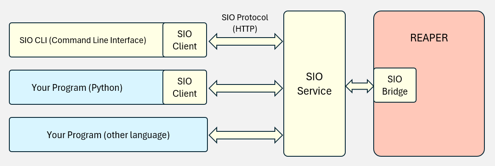

# REAPER Score IO (SIO)

[日本語](README.md) | English

REAPER SIO is a common interface that lets research and educational programs read and write the notes entered in the piano roll of REAPER, a digital audio workstation.

It is intended for researchers in composition and arrangement who build score analysis programs, composition support programs, or interactive teaching materials.

## Background and purpose

Until now, studying interaction with composers, such as computer-assisted composition and arrangement, has required researchers to build a simple piano roll of their own and play it back with a simple sound source. Neither the ease of input nor the sound quality matches the tools used in real music production. The piano roll also has to be rebuilt for each research topic.

Classical teaching materials for composition and arrangement explain everything with notation. They are efficient only for people who can play a score at sight or hear the exact notes in their head.

SIO leaves this part to production software.

- **Input and editing** are done in REAPER's full-featured piano roll.
- **Sound** comes from the commercial software instruments loaded in REAPER.
- **Analysis and evaluation** are done by programs that researchers write.
- SIO sits between the two and passes the note data back and forth.

Instead of building a piano roll and a sound source, researchers can concentrate on the analysis and on the content of the teaching material. Because SIO is a common entry point, analysis programs and teaching materials written by different people all run on the same REAPER.



## What SIO can do

A program can do the following. The target is the project in REAPER's active tab. The learner does not need to select a track or press any button in REAPER.

| Capability | Example |
|---|---|
| Read notes | All notes in every part, the notes in bars 1–2, the notes sounding at bar 4, beat 2 |
| Select notes | Show two notes that form parallel fifths by selecting them in the piano roll |
| Add, change, and delete notes | Write a model answer, correct a note that was pointed out |
| Play a range | Play only the two bars that contain a problem |
| Read project information | The list of parts (tracks), time signatures, the range that contains notes |
| Prepare a project and its parts | Create a new project, add a track with an instrument, prepare the bars where an answer will be entered |

Notes are exchanged as numbers: pitch (MIDI note number), start position, duration, velocity, and so on. A position can be given either as a number where a quarter note is 1, or as a bar and a beat.

SIO itself makes no musical judgments. Harmonic analysis, voice separation, enharmonic spelling, and grading are done by the program that uses SIO. SIO handles only the notes in the piano roll.

## Requirements

- macOS or Windows 11 (the environments where SIO has been checked; Linux is untested)
- [REAPER](https://www.reaper.fm/) 7.x
- [Python](https://www.python.org/) 3.11 or later

## Getting started

### 1. Set up SIO

Open a terminal and run the following commands in this folder. This is needed only once.

```bash
python3 -m pip install -r requirements.txt
python3 -m sio_service.install
```

The second line installs the component that runs inside REAPER (SIO Bridge). Restart REAPER afterwards. From then on, the Bridge starts automatically whenever REAPER starts.

### 2. Prepare a project in REAPER

Open a project in REAPER, create a track for each part, and place MIDI items on the tracks. SIO treats **one named track as one part**, so give each track a unique name such as "Soprano" or "Cello".

Tracks can also be added from SIO (`add_track "Cello" "instrument name"` in sio_cli, step 4). If the instrument is not found, a track without an instrument is added. MIDI items can be added in the same way, for example `add_item "Cello" b1..b9` (bars 1–8).

### 3. Start SIO Service

```bash
python3 -m sio_service
```

Leave this window open. Both REAPER and SIO Service must be running while you use SIO.

### 4. Try it by hand

In another window, start sio_cli, a tool for checking SIO by hand.

```bash
python3 -m sio_cli
```

When `sio> ` appears, type a command. Results are shown as JSON.

```
sio> get_status                      Check the connection
sio> get_score_info                  Show the parts and time signatures
sio> get_notes                       Read the notes in every part
sio> get_notes Cello range=b1..b3    Read bars 1-2 of Cello
sio> get_notes at=4:2                Read the notes sounding at bar 4, beat 2
sio> select_notes Cello:C3@4:2       Select the C3 at bar 4, beat 2 of Cello
sio> play_range b1..b3               Play bars 1-2
sio> insert Cello:G2@5:1 dur=2       Add a G2, two quarter notes long, at bar 5, beat 1 of Cello
sio> create_project                  Create a new project
sio> add_track Viola ReaSynth        Add a track named Viola with the instrument ReaSynth
sio> add_item Viola b1..b9           Create an empty MIDI item for entering notes in bars 1-8 of Viola
sio> help                            List the commands
sio> exit                            Quit
```

If the result of `get_status` contains `"bridge_state": "connected"`, SIO is connected to REAPER. Each edit can be undone with a single ordinary Undo in REAPER.

The messages and help text of sio_cli are in Japanese.

### 5. Use it from your own program

From Python, use the bundled library sio_client. Install it into the Python that runs your program with the following command (nothing else is installed along with it).

```bash
python3 -m pip install ~/ReaperScoreInterface
```

Replace the folder with the location where you put SIO. After that, you can write code like this:

```python
from sio_client import SIO

sio = SIO()                                   # The connection settings are found automatically

# Read the notes in bars 1-2 from every part.
for note in sio.notes(bars=(1, 2)):
    print(note.part, note.pitch, f"bar {note.bar}, beat {note.beat}", note.duration)

# Select the notes that are too high in REAPER, and play that bar.
too_high = [n for n in sio.notes("Soprano") if n.pitch > 81]
if too_high:
    sio.select_notes(too_high)
    sio.play(bars=too_high[0].bar, wait=True)

# Add a C3, two quarter notes long, at bar 5, beat 1 of Bass.
sio.insert("Bass", "C3", (5, 1), duration=2)
```

A position is written as `(bar, beat)` or as a number where a quarter note is 1. A pitch is written as a MIDI note number or as a note name such as `"C4"` (= 60). The full list of methods is in [SIO_Client_Library_Specification_ja.md](SIO_Client_Library_Specification_ja.md) (in Japanese).

Ready-to-run sample programs are in the [examples](examples/README.md) folder: a round of "Froschgesang" (the frog song), chord analysis, detection of parallel fifths, and a harmony exercise that is set and evaluated. Run one like this:

```bash
python3 examples/frog_round.py
```

SIO can also be used from languages other than Python. It provides an HTTP endpoint that is reachable only from the same computer: send a JSON request and a JSON response comes back. The format is described in [SIO_Protocol_Specification_en.md](SIO_Protocol_Specification_en.md).

For a harmony exercise, the flow is roughly as follows.

1. The program sets a task ("Add three upper voices to the following bass").
2. The learner enters an answer in REAPER's piano roll and checks it with the instrument.
3. The learner submits in the program. The program reads the relevant bars with `sio.notes(...)`.
4. The program evaluates the answer. It selects the problem notes with `sio.select_notes(...)` and plays that passage with `sio.play(...)`.
5. The learner corrects the answer and submits again.

## Notes on preparing a project

So that SIO can read and write correctly, prepare the projects used for teaching or analysis as follows. When a condition is not met, SIO does not skip anything silently; it returns an error or a warning with the reason. `get_score_info` shows which parts of the project do not meet the conditions.

- **Give each part's track a unique name.** A track without a name is not treated as a part.
- **Start the project with a complete bar.** Pickup bars (anacrusis) are not supported. For a piece with a pickup, fill the first bar with rests.
- **Change the time signature only at the start of a bar.** Tempo can be changed freely.
- **Use MIDI items created in the ordinary way.** Items with multiple takes, overlapping items, items extended by looping, and pooled items are not supported. Placing several items side by side on one track is fine.
- **Do not overlap notes of the same pitch on the same channel.**
- **Do not create notes that cross the edge of an item.** When you shorten an item, make sure no note sticks out.

## Good to know

- **How beats are counted**: A "beat" in SIO is the note value of the time signature's denominator. A bar of 6/8 has six beats; it is not counted as two dotted-quarter beats.
- **Note numbers (note_id) are temporary**: Notes that are read are numbered from 1 within each part. Adding or deleting notes renumbers them, so read the notes again after editing. A note can also be specified by its pitch and start position instead of its number.
- **The project in the active tab is the target**: SIO reads and writes the project in REAPER's active tab. When several projects are open, switching tabs switches the target. When a program specifies a project with `select_project`, that project's tab comes to the front. The track selected in REAPER has no effect. (When a program chooses a part with `select_part`, that track also becomes selected in REAPER, but the program's target does not change if a person then selects another track.)
- **For use within one computer only**: SIO does not accept connections from the network.
- **Nothing is saved**: SIO never saves a project automatically. Save new projects created through SIO in REAPER as well.
- **Instrument settings are made in REAPER**: SIO goes only as far as loading an instrument onto a track. Choose the sound (preset) and adjust the controls in REAPER.

## Why REAPER

There are many full-featured music production applications (DAWs), but SIO targets REAPER only. The reasons are as follows.

- **External programs can read and write notes.** REAPER has a public mechanism for controlling the application from inside (ReaScript), which can read and change the notes in the piano roll one by one. Many DAWs have no such mechanism, or have one that does not reach the content of the notes. SIO depends on this.
- **Any instrument can be used.** REAPER loads software instruments in standard formats (such as VST). Researchers and learners can use the instruments they already own.
- **It is easy to adopt.** The application is small and light, and runs on Windows, macOS, and Linux. The license is comparatively inexpensive, and no features are restricted during the evaluation period. This matters when every participant in a class or workshop has to install it.
- **The piano roll is practical.** It has the features used in production, such as note entry and editing, showing several parts at once, and playing a specified range.

On the other hand, REAPER is not strong at displaying or engraving notation, and it is not widely used in classical music. Because SIO uses the piano roll as the place for input and checking, we judged that this is not a major limitation for its purpose.

The ideas behind SIO (how note positions are expressed, how parts are handled, how edits are carried out) are not specific to REAPER, but the current implementation works only with REAPER.

## Relationship to MCP

MCP (Model Context Protocol) is widely used as a way to let AI assistants use external tools. SIO is not a replacement for MCP; it is a foundation that sits beneath it.

MCP defines a common way of connecting, through which an AI calls tools. SIO defines the content: how piano-roll notes are handled for research and education. This includes how positions are expressed with bars and beats, how notes are numbered, how multiple parts and items are brought together, how an edit is kept from failing halfway, and how the same edit is kept from being applied twice when the connection is lost. These have to be decided separately even when MCP is used.

The programs that use SIO are also not necessarily AI. A program that analyzes harmony by rules, or teaching material that sets and grades tasks by a fixed procedure, must be able to perform the same operation in the same way every time, without going through an AI. For this reason SIO is a simple HTTP and JSON endpoint that can be called in a few lines from any programming language.

To use SIO from an AI assistant, a thin MCP server can be placed on top of it. In that case the handling of notes still follows the SIO specification, so teaching materials that use AI and those that do not behave the same way on the same REAPER. (An MCP server is not included at present.)

## Further reading

| Document | Content |
|---|---|
| [examples/README.md](examples/README.md) | Sample programs that use sio_client, with explanations (Japanese) |
| [SIO_Client_Library_Specification_ja.md](SIO_Client_Library_Specification_ja.md) | How to use the Python library sio_client: methods, argument formats, errors (Japanese) |
| [SIO_Protocol_Specification_en.md](SIO_Protocol_Specification_en.md) | The formal specification for use from programs: every request and response, and the list of errors |
| [SIO_CLI_Specification_ja.md](SIO_CLI_Specification_ja.md) | The commands and syntax of the checking tool sio_cli (Japanese) |
| [SIO_Specification_ja.md](SIO_Specification_ja.md) | The internal design of SIO (Japanese) |
| [README_dev.md](README_dev.md) | Material for people who develop and verify SIO itself (Japanese) |

## Troubleshooting

| Symptom | What to check |
|---|---|
| sio_cli reports that it cannot connect (接続できません) | Is SIO Service (step 3) running? |
| `bridge_state` is `unavailable` | Is REAPER running? Did you restart REAPER after step 1? |
| A different project is read | The project in REAPER's active tab is the target. Bring the tab of the project you want to the front, or check the name with `list_projects` and run `select_project "name.rpp"` |
| The error `PART_NOT_FOUND` | Does the track name match exactly, including upper and lower case and spaces? |
| Errors such as `UNSUPPORTED_ITEM` | Something does not meet "Notes on preparing a project". The reason appears in `constraints` of `get_score_info` |

To remove SIO, run `python3 -m sio_service.install --uninstall`.

## License

The SIO programs (SIO Service, SIO Bridge, sio_client, sio_cli, and the sample programs) are released under the MIT License. The full text is in [LICENSE](LICENSE).

Copyright (c) 2026 aike

One of the sample programs (`examples/frog_round.py`) uses a public-domain melody: the German folk tune (composer unknown) known in Japan as "Kaeru no Gasshō". No lyrics are included.
